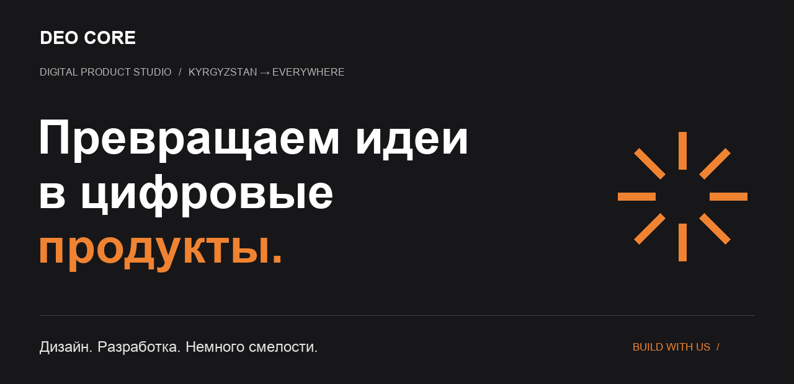
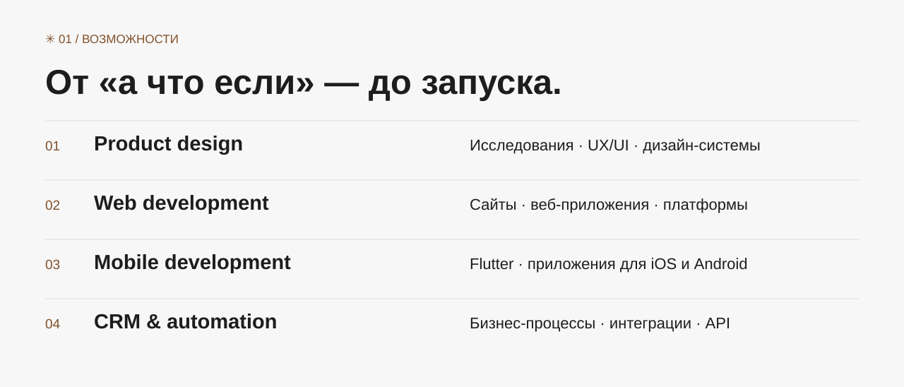
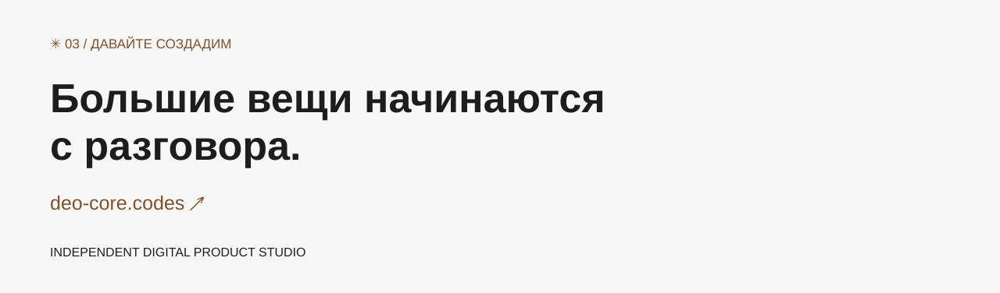

# DEO CORE

**Независимая студия цифровых продуктов из Кыргызстана.** Соединяем стратегию, дизайн и разработку — от первого вопроса до запуска.

[Сайт ↗](https://www.deo-core.codes) · [Публичные проекты ↓](#публичные-проекты) · [Обсудить проект ↗](mailto:deocore@gmail.com) · [Hero без анимации](https://raw.githubusercontent.com/DEO-CORE/.github/d5b0c63e6afc162f65772c4f3a8ff4ce31dd22e1/profile/hero-static.png)

## От идеи до продукта

**01 / Разобраться** — изучить задачу, пользователей и ограничения.  
**02 / Спроектировать** — соединить сценарии, интерфейс и систему.  
**03 / Разработать** — собрать продукт, проверить и подготовить запуск.  
**04 / Развивать** — поддерживать и улучшать после релиза.

## Публичные проекты

| Проект | Что внутри | Технологии |
| :--- | :--- | :--- |
| [**ARTA ↗**](https://github.com/DEO-CORE/hackathon-arta) | Платформа повторного использования текстильных остатков. Хакатонный прототип; React-демо работает с локальными данными. | Flutter · React · FastAPI · PostgreSQL |
| [**KISA Ecommerce ↗**](https://github.com/DEO-CORE/kisa_ecommerce) | Интернет-магазин KISA: фронтенд, API, админка и материалы по развёртыванию. | React · TypeScript · Django · PostgreSQL · Redis |
| [**TermoClimat.kg ↗**](https://github.com/DEO-CORE/termoclimat-kg) | Сайт для организации TermoClimat.kg. | TypeScript |

[Все публичные репозитории организации ↗](https://github.com/orgs/DEO-CORE/repositories?type=public)

## Инструменты под задачу

**Web** / React · Next.js · TypeScript  
**Mobile** / Flutter · Dart  
**Backend** / Python · Django · FastAPI  
**Data** / PostgreSQL · Redis

Технологии выбираем под продукт. Дизайн и разработка работают вместе — с первого разговора до запуска.

**Есть идея или сложная задача?** [Расскажите нам ↗](mailto:deocore@gmail.com)

[deo-core.codes](https://www.deo-core.codes) · [deocore@gmail.com](mailto:deocore@gmail.com)  
Кыргызстан · Работаем без границ.
